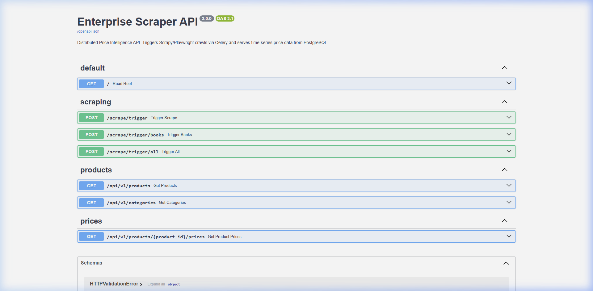
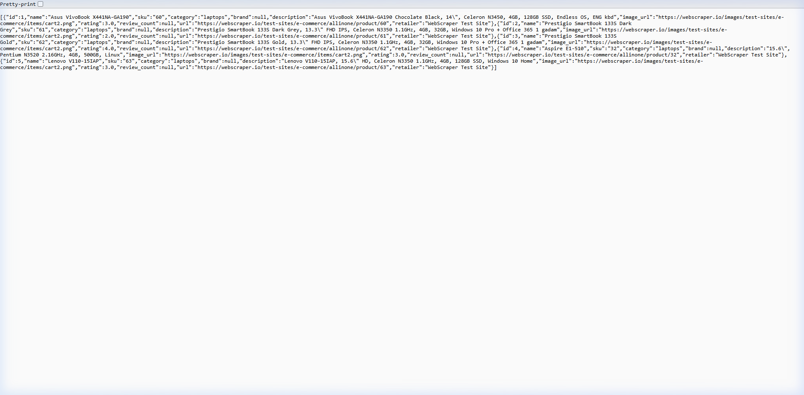
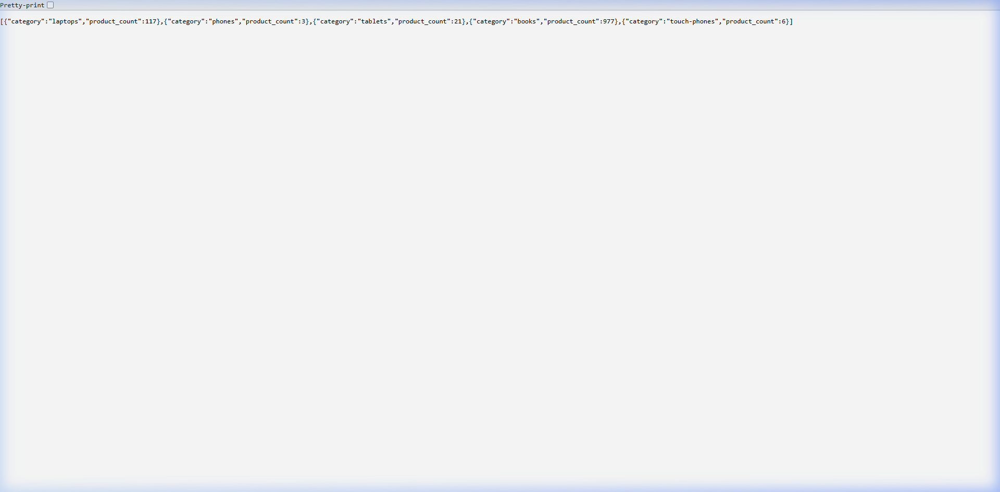
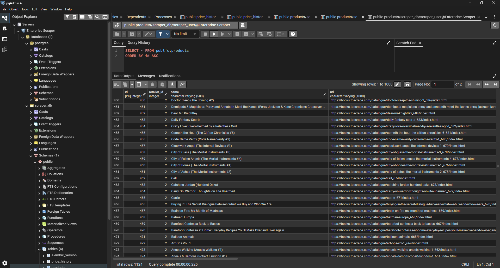

# ScrapForge

> A production-grade, distributed web scraping pipeline for real-time e-commerce price tracking. Built with Scrapy, Playwright, Celery, FastAPI, PostgreSQL, and Redis — fully containerised with Docker.

---

## 📸 Screenshots

### API Documentation (Swagger UI)


### Live Products Endpoint — Enriched Data


### Categories Summary Endpoint


### pgAdmin — Database View (1,124 Products)


> Shows `scraper_db` with all 4 tables (`alembic_version`, `price_history`, `products`, `retailers`) and the `products` table results — 1,124 total rows, query completed in 0.225s.

**Tables in `scraper_db`:**
| Table | Description |
|---|---|
| `retailers` | Source website metadata |
| `products` | 1,124+ unique products with enriched fields |
| `price_history` | Time-series price snapshots (grows every scrape) |

---

## 🏗️ Architecture

```
┌────────────────────────────────────────────────────────────┐
│                        Docker Compose                       │
│                                                            │
│  ┌──────────┐   POST /scrape   ┌──────────────────────┐   │
│  │          │ ────────────────▶│  Celery Worker        │   │
│  │ FastAPI  │                  │  (Redis Broker)       │   │
│  │ :8000    │◀── JSON ──────── │                       │   │
│  └──────────┘                  │  ┌─────────────────┐  │   │
│       │                        │  │ Scrapy + Play-  │  │   │
│       │                        │  │ wright Spiders  │  │   │
│       ▼                        │  └────────┬────────┘  │   │
│  ┌──────────┐                  └───────────┼───────────┘   │
│  │PostgreSQL│◀──── SQLAlchemy  ────────────┘               │
│  │  :5432   │      ORM + Alembic                           │
│  └──────────┘                                              │
│                                                            │
│  ┌──────────┐                                              │
│  │  Redis   │  ← Task Queue / Result Backend               │
│  │  :6379   │                                              │
│  └──────────┘                                              │
└────────────────────────────────────────────────────────────┘
```

---

## ⚙️ Tech Stack

| Layer | Technology |
|---|---|
| **Scraping** | [Scrapy 2.11](https://scrapy.org/) |
| **JS Rendering** | [Playwright](https://playwright.dev/) via `scrapy-playwright` |
| **Task Queue** | [Celery 5](https://docs.celeryq.dev/) + [Redis 7](https://redis.io/) |
| **API** | [FastAPI](https://fastapi.tiangolo.com/) + [Uvicorn](https://www.uvicorn.org/) |
| **Database** | [PostgreSQL 15](https://www.postgresql.org/) |
| **ORM** | [SQLAlchemy 2](https://www.sqlalchemy.org/) |
| **Migrations** | [Alembic](https://alembic.sqlalchemy.org/) |
| **Validation** | [Pydantic v2](https://docs.pydantic.dev/) |
| **Infrastructure** | [Docker](https://www.docker.com/) + [Docker Compose](https://docs.docker.com/compose/) |

---

## 🗂️ Project Structure

```
scrapforge/
├── docker-compose.yml          # All 4 services: Postgres, Redis, API, Worker
